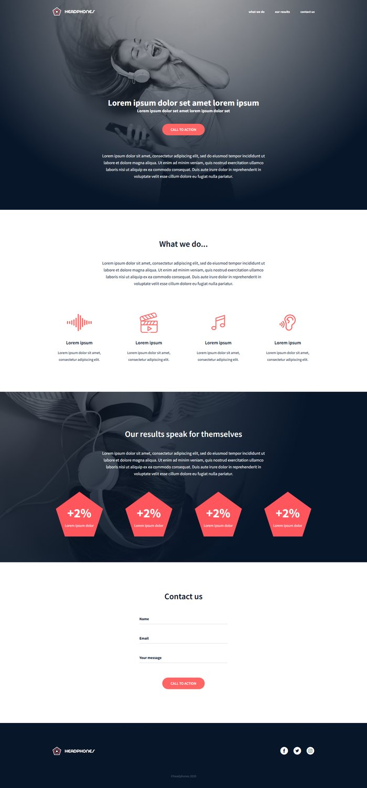
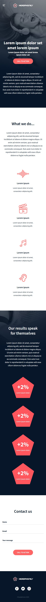

# Headphones - Implement a design from scratch

This project is the landing page of **Headphones**, a fictional headphone company, built from scratch with only HTML and CSS from a Figma design by Nicolas Philippot (UI/UX designer). No CSS framework and no JavaScript are used. The page has a hero header, a "What we do..." section with custom icon-font icons, an "Our results" section with pentagon statistics, a contact form and a footer. It is responsive: the content is limited to 1000px and centered on large screens, the items rearrange on tablets, and the page switches to its mobile version when the screen width is 480px or less. The layout was checked pixel by pixel against the designer's final desktop and mobile screens.

<p align="center">
  
  &nbsp;&nbsp;
  
</p>

## Tasks

Each task starts from the files of the previous one and adds a new part of the page.

| # | Task | Files |
|---|------|-------|
| 0 | Read and be familiar with Figma | `README.md` |
| 1 | Header / hero | `0-index.html`, `0-styles.css` |
| 2 | "What we do..." section | `1-index.html`, `1-styles.css` |
| 3 | "Our results" section | `2-index.html`, `2-styles.css` |
| 4 | Contact us form | `3-index.html`, `3-styles.css` |
| 5 | Footer (complete page) | `4-index.html`, `4-styles.css` |
| 6 | Pentagons drawn in CSS, without any image file | `100-index.html`, `100-styles.css` |
| 7 | Animations on the items rows | `101-index.html`, `101-styles.css` |
| 8 | SASS version of `101-styles.css` | `102-styles.scss` |

## Features

- **Reset and variables**: a small CSS reset, then colors, fonts and sizes stored in CSS custom properties (`--color-primary`, `--color-dark`, ...).
- **Reusable components**: `.container`, `.button`, `.link`, `.icon`, `.title`, `.text`, and the `.items` / `.item` row shared by "What we do..." and "Our results".
- **Interactions**: links turn `#FF6565` on hover/active, buttons get `opacity: 0.9`.
- **Responsive**: 4 items per row on desktop, 2 per row on tablets (900px and less), one column on mobile (480px and less).
- **Mobile menu without JavaScript**: the hamburger is a `<label>` for a hidden checkbox; `:checked` opens the menu.
- **Custom icon font**: `holberton_school-icon` (menu, sound, video, music, hearing, Facebook, Twitter, Instagram).
- **Contact form**: real `<label>`s that float above the field when it is focused or filled, an animated underline, and field constraints (`required`, `type="email"`, `minlength`, `maxlength`). An invalid filled field turns red.
- **CSS pentagons** (task 6): a colored box cut with `clip-path: polygon(...)` into a regular pentagon, with the same size and position as the image version.
- **Animations** (task 7): items lift on hover, each icon has its own hover animation (equalizer, wiggle, bounce, pulse), and the pentagons float continuously and spin on hover. All of it is turned off for users who set `prefers-reduced-motion`.
- **Accessibility**: semantic tags (`header`, `nav`, `main`, `section`, `footer`), `alt` texts, `aria-label` on icon links, visible keyboard focus.

## Design

| Token | Value |
|-------|-------|
| Primary (buttons, icons, pentagons, hover) | `#FF6565` |
| Dark (text, footer) | `#071629` |
| Form underline | `#D3D6D9` |
| Copyright | `#5E6874` |
| Font | [Source Sans Pro](https://fonts.google.com/specimen/Source+Sans+Pro) 400 / 600 / 700 |
| Content width | 1000px, centered |
| Mobile breakpoint | 480px |

## Usage

Open any `*-index.html` file in a browser (`4-index.html` is the complete page). The text font is loaded from Google Fonts, so an internet connection is needed for Source Sans Pro; the icon font is local, in `fonts/`.

To build the CSS of task 7 from the SASS file:

```bash
sass 102-styles.scss > 101-styles.css
```

`102-styles.scss` uses Sass variables, mixins for the breakpoints, nesting with `&`, maps with `@each` for the icon glyphs and the icon animations, and a `@for` loop for the animation delays.

## Project structure

```
holbertonschool-headphones/
├── 0-index.html ... 4-index.html     # one file per task, each adds a section
├── 0-styles.css ... 4-styles.css
├── 100-index.html / 100-styles.css   # pentagons in pure CSS
├── 101-index.html / 101-styles.css   # animations
├── 102-styles.scss                   # SASS version of 101-styles.css
├── fonts/                            # holberton_school-icon font
└── images/                           # hero pictures, logo, pentagon, favicon, screenshots
```

## Credits

- Design: Nicolas Philippot, UI/UX designer
- Project: [Holberton School](https://www.holbertonschool.com/)
- Author: [elvinaliyevse-lab](https://github.com/elvinaliyevse-lab)
